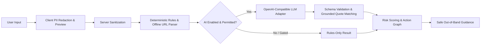

# Architecture

OvěřTo.AI is structured as an evidence-first, privacy-conscious analysis pipeline designed to evaluate suspicious messages, detect deceptive communication patterns, and provide actionable out-of-band verification guidance.

## Core Analysis Pipeline

1. **Client Redaction & Preview:** Best-effort pattern matching removes potential identifiers (phone numbers, email addresses, personal names) in the browser, offering an editable preview before submission.
2. **Server Sanitization & Request Bounding:** Payloads are bounded by size and character limits, with secondary server-side sanitization.
3. **Deterministic Heuristic Rules:** A rule engine evaluates regular expressions, fraud phrasing, urgency cues, financial triggers, and offline URL characteristics (homoglyphs, misleading TLDs, IP hosts) without initiating external HTTP connections to untrusted domains.
4. **Optional LLM Inference:** When enabled with explicit consent, redacted text is dispatched to a registered OpenAI-compatible model endpoint. The adapter strictly verifies structured JSON output and checks that every cited quote appears verbatim in the input text. Model suggestions cannot downgrade a deterministic high-risk rule match.
5. **Action Graph & Evidence Attribution:** UTF-16 span indices map detected signals directly to source text excerpts, ensuring transparent reasoning rather than black-box categorization.
6. **Verification Guidance:** Contextual recommendations provide official contact routes and safe handling steps for urgent scenarios (e.g., bank impersonation, parcel delivery fraud).

## Authentication & Multi-Tenancy

- **Identity Management:** Built on Better Auth with email verification, secure session cookies, password reset workflows, and role-based access control (`USER` and `ROOT`).
- **Workspace & Project Isolation:** Users operate within isolated workspaces containing scoped projects, individual API key allocations, and credit balances.
- **Transactional Credit Ledger:** A double-entry PostgreSQL ledger (`credit_ledger`) tracks allocations, usage deductions, Stripe checkout grants, and partial refund adjustments atomically.

## Abuse Prevention & Rate Limiting

- **Distributed Client Identity:** Client IP addresses are securely hashed using rotating salt tokens (`src/server/security/client-identity.ts`) behind trusted reverse proxies (`TRUSTED_PROXY_HOPS`).
- **Shared PostgreSQL Rate Limiting:** Enforces sliding-window request limits for anonymous guests and authenticated tenant API keys (`src/lib/shared-rate-limit.ts`).
- **Process Protection:** In-memory concurrency and request-size bounds safeguard individual application instances.

## AI Budget Accounting & Operational Safety

- **Atomic Budget Guard:** The `AiBudgetGuard` (`src/server/ai/budgets.ts`, `migrations/016_ai_budget_reservations.sql`) uses PostgreSQL advisory and row-level locks to manage daily and monthly financial ceilings.
- **Pre-Allocation & Settlement:** Token consumption and estimated costs are reserved prior to external invocation and settled or released post-execution. Requests fail closed upon budget exhaustion.
- **Production Gating:** Production environments default to **Rules-only** mode via the `AI_LOCAL_ONLY` security gate, preventing unintended external provider costs or exposure.
- **Zero Content Persistence:** Raw message contents submitted for analysis are processed in memory and never stored in the database. Only operational telemetry (token counts, latency, estimated USD cost) is recorded in administrative trace logs.
