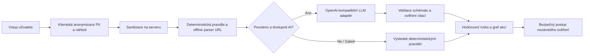

<div align="center">


# OvěřTo.AI

**Open-source platforma pro detekci podvodů a nezávislé ověřování zpráv.**

Asistent založený na důkazech pro české a vícejazyčné zprávy. Pomáhá analyzovat podezřelé komunikace, rozpoznávat ověřené podvodné znaky a bezpečně ověřovat žádosti dříve, než dojde k nevratným krokům.

[](https://github.com/yuanweize/OverTo.AI/actions/workflows/ci.yml)
[](https://github.com/yuanweize/OverTo.AI/releases)
[](LICENSE)
[](https://github.com/users/yuanweize/packages/container/package/overto.ai)

[Rychlý start](#rychlý-start) · [Klíčové funkce](#klíčové-funkce) · [Vizuální přehled](#vizuální-přehled) · [Architektura](#jak-to-funguje) · [API](#rozhraní-api-v-kostce) · [Vlastní provoz](docs/deployment/self-host.md) · [Dokumentace](#dokumentace) · [English](README.md)

</div>

<p align="center">
  
  <br />
  <sub><strong>Analýza zpráv založená na důkazech (Desktop)</strong> — Transparentní vyhodnocení podvodných signálů, kalibrované skóre rizika a bezpečné kroky nezávislého ověření.</sub>
</p>

---

## Klíčové funkce

- **Deterministická pravidla a hodnocení rizika**  
  Rychlé heuristické rozpoznávání vzorů a offline analýza URL adres, která odhaluje podvržené domény, homoglyfy, časový nátlak a finanční podvody bez otevírání cizích odkazů.
- **Ochrana soukromí a klientská anonymizace**  
  Odstranění osobních identifikačních údajů (PII) probíhá přímo v prohlížeči před odesláním na server, s možností interaktivní kontroly a úpravy náhledu.
- **Podložené důkazy a graf akcí (Action Graph)**  
  Propojuje konkrétní znaky ve zdrojovém textu přímo s rozpoznanými varovnými signály, což poskytuje srozumitelné odůvodnění namísto neprůhledné klasifikace.
- **Bezpečné doporučené kroky ověření**  
  Doporučuje oficiální nezávislé komunikační kanály a postupy pro krizové situace (např. falešné bankovní výzvy nebo podvody s doručováním zásilek).
- **Vývojářské API a OpenAPI 3.1**  
  Verzovaný REST koncový bod (`/api/v1/analyses`), projektové API klíče s denními limity spotřeby a interaktivní testovací prostředí (API Playground).
- **Provoz ve vlastní infrastruktuře (Self-Hosting) a AI Studio**  
  Kompletní produkční stack pro Docker Compose s PostgreSQL 17, Better Auth s ověřováním e-mailů, podvojnou kreditní knihou, testovací fakturací Stripe a administrátorským AI Studiem chráněným atomickými finančními rozpočty.

---

## Vizuální přehled

Výběr klíčových obrazovek platformy OvěřTo.AI pro desktopová i mobilní zařízení.

### 1. Analýza založená na důkazech a textové signály

*Detailní výsledek analýzy se zvýrazněnými citacemi z textu, stupněm rizika a doporučeným postupem.*

### 2. Klientský dashboard a pracovní prostor

*Uživatelský dashboard s přehledem zůstatku kreditů, aktivních projektů a denního objemu požadavků.*

### 3. Vývojářské nástroje a přístupná dokumentace API

*Referenční dokumentace API ověřená podle standardu přístupnosti WCAG AA s ukázkami kódu a schématy odpovědí.*

### 4. Správa platformy a AI Studio (pouze ROOT)

*Provozní telemetrie v reálném čase: spotřeba tokenů, latence, odhad nákladů v USD a atomické vynucování rozpočtu v PostgreSQL.*

👉 *Kompletní katalog všech 52 snímků rozhraní, mobilních zobrazení a porovnání motivů naleznete v [Galerii rozhraní](docs/showcase.md).*

---

## Rychlý start

### 1. Místní vývoj (Rules-Only)

Nejrychlejší způsob, jak spustit OvěřTo.AI lokálně. Běží zcela offline s deterministickými pravidly bez nutnosti databáze nebo API klíčů:

```sh
# Klonování repozitáře
git clone https://github.com/yuanweize/OverTo.AI.git
cd OverTo.AI

# Instalace závislostí a spuštění vývojového serveru
npm ci
npm run dev -- -p 3005
```

Otevřete [http://127.0.0.1:3005](http://127.0.0.1:3005) v prohlížeči.

### 2. Produkční self-hosted provoz (Docker Compose)

Spuštění kompletní více-uživatelské aplikace s PostgreSQL 17, automatickými migracemi, autentizací a odesíláním e-mailů:

```sh
# 1. Příprava konfiguračního souboru
cp .env.selfhost.example .env.selfhost
# Upravte .env.selfhost podle své domény, hesel a nastavení SMTP

# 2. Spuštění služeb (PostgreSQL, automatické migrace, Next.js aplikace)
docker compose --env-file .env.selfhost -f compose.saas.yaml up -d --build

# 3. Inicializace hlavního administrátora platformy (ROOT)
docker compose --env-file .env.selfhost -f compose.saas.yaml run --rm --no-deps migrate \
  ./node_modules/.bin/tsx scripts/bootstrap-admin.ts admin@vasedomena.cz
```

Aplikace bude dostupná na `http://127.0.0.1:3006`. Podrobný popis nastavení reverzní proxy, zálohování a proměnných prostředí naleznete v [Průvodci vlastním provozem](docs/deployment/self-host.md).

---

## Jak to funguje



1. **Kontrola a anonymizace:** Citlivé osobní údaje (jména, telefonní čísla, e-maily) jsou před odesláním skryty v prohlížeči s možností ruční úpravy.
2. **Deterministická pravidla:** Text i odkazy procházejí heuristickou kontrolou a strukturální analýzou URL bez načítání cizích webových stránek.
3. **Volitelné vyhodnocení AI:** Pokud je AI výslovně povoleno správcem a uživatelem, OpenAI-kompatibilní model navrhne strukturované signály. Výstup musí projít přísnou validací JSON schématu a doslovnou kontrolou citací z původního textu.
4. **Graf akcí:** Rozpoznané signály odkazují přímo na konkrétní úseky ve vstupní zprávě.
5. **Doporučený postup:** Poskytuje bezpečné nezávislé kroky ověření přizpůsobené konkrétnímu typu podvodu.

---

## Rozhraní API v kostce

Anonymní volání nevyžaduje **žádný API klíč** a vyhodnocuje se pomocí deterministických pravidel:

```sh
curl http://127.0.0.1:3005/api/v1/analyses \
  -H "Content-Type: application/json" \
  --data '{"text":"Vážený kliente, váš účet byl zablokován. Klikněte zde: https://csob-zabezpeceni.cz", "enableLlm":false}'
```

Ukázka odpovědi:

```json
{
  "decision": "LIKELY_SCAM",
  "score": 85,
  "engine": "RULES_ONLY",
  "signals": [
    {
      "id": "BANK_IMPERSONATION",
      "severity": "CRITICAL",
      "evidenceQuote": "váš účet byl zablokován",
      "description": "Urgent account blockage claim typical of banking fraud."
    }
  ],
  "recommendedActions": [
    "Neklikejte na odkaz a nezadávejte přihlašovací údaje.",
    "Kontaktujte svou banku přímo na telefonním čísle uvedeném na zadní straně platební karty."
  ]
}
```

Ověřené požadavky používají Bearer token s denními limity. Podrobnosti naleznete v [Referenční příručce API](docs/api/v1.md) a [Specifikaci OpenAPI](docs/api/openapi.yaml).

---

## Dokumentace

| Oblast | Popis | Odkaz |
|---|---|---|
| **Nasazení** | Produkční Docker Compose, konfigurace prostředí a zálohování | [Průvodce vlastním provozem](docs/deployment/self-host.md) |
| **Render Blueprint** | Konfigurace cloudového nasazení na platformě Render | [Render Demo Guide](docs/deployment/render-demo.md) |
| **API Reference** | Koncové body, autentizace, rychlostní limity a schémata | [docs/api/v1.md](docs/api/v1.md) |
| **OpenAPI Specifikace** | Strojově čitelná specifikace OpenAPI 3.1 | [openapi.yaml](docs/api/openapi.yaml) |
| **Architektura** | Systémové procesy, více-uživatelská správa a rozpočty | [ARCHITECTURE.md](ARCHITECTURE.md) |
| **Správa AI modelů** | Integrace modelů, ochrana rozpočtu a soukromí | [AI_USAGE.md](AI_USAGE.md) |
| **Provozní limity** | Technická a bezpečnostní omezení systému | [LIMITATIONS.md](LIMITATIONS.md) |
| **Správa platformy** | Správa uživatelů, auditní záznamy a systémové metriky | [Operations Guide](docs/administration/operations.md) |
| **AI Studio** | Telemetrie, Prompt Lab a registr poskytovatelů | [AI Traces](docs/administration/ai-traces.md) · [Prompt Lab](docs/administration/prompts.md) |
| **Vizuální katalog** | Kompletní přehled všech 52 snímků rozhraní aplikace | [Galerie rozhraní](docs/showcase.md) |
| **Evaluace** | Testovací scénáře a metodika vyhodnocování | [docs/evaluation/ai-evaluation.md](docs/evaluation/ai-evaluation.md) |
| **Testování** | Bezpečnostní, integrační a nasazovací testovací plány | [Bezpečnost](docs/testing/SECURITY-TEST-PLAN.md) · [E2E](docs/testing/FULL-E2E-TEST-PLAN.md) · [Nasazení](docs/testing/DEPLOYMENT-TEST-PLAN.md) |

---

## Provozní omezení

- **Žádná záruka bezpečnosti:** Deterministická pravidla ani volitelné AI modely nezaručují 100% spolehlivost detekce. Výsledek `INSUFFICIENT_EVIDENCE` neznamená potvrzení pravosti či bezpečnosti zprávy.
- **Nezávislé ověření je nutné:** Jakýkoliv neočekávaný nebo urgentní požadavek týkající se financí či údajů je třeba ověřit přes spolehlivý oficiální kontakt.
- **Pravidla v produkci:** Veřejné kontejnery standardně běží v režimu **Rules-only** (`AI_LOCAL_ONLY`). Volání externích AI modelů je vypnuto, pokud jej správce výslovně neaktivuje a nenastaví rozpočty.
- **Klientská anonymizace:** Automatické odstraňování PII maskuje běžné formáty (telefon, e-mail, jména), nemůže však zajistit stoprocentní odstranění všech kontextových indicií.
- Podrobný přehled technických hranic viz [LIMITATIONS.md](LIMITATIONS.md).

---

## Vývoj a testování

```sh
# Spuštění jednotkových a integračních testů
npm test

# Kontrola typů a linting
npx tsc --noEmit
npm run lint

# Ověření odkazů v dokumentaci a kontrola hesel
npm run docs:check
npm run secrets:check

# Produkční sestavení
npm run build
```

---

## Příspěvky a bezpečnost

- Příspěvky do repozitáře jsou vítány! Před vytvořením Pull Requestu si prosím přečtěte [CONTRIBUTING.md](CONTRIBUTING.md).
- Hlášení bezpečnostních zranitelností se řídí pravidly v [SECURITY.md](SECURITY.md). Nezveřejňujte zranitelnosti ve veřejných issues repozitáře.

## Licence

Tento projekt je licencován pod licencí [Apache-2.0](LICENSE).
Licence a oznámení komponent třetích stran jsou uvedeny v souboru [THIRD_PARTY_NOTICES.md](THIRD_PARTY_NOTICES.md).
