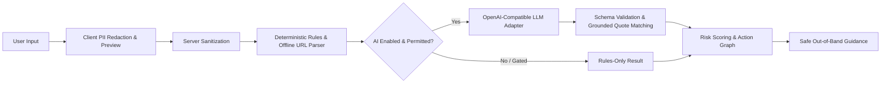

<div align="center">


# OvěřTo.AI

**Open-source scam detection and verification platform.**

An evidence-led assistant for Czech and multilingual messages, helping people examine suspicious communications, identify grounded warning signs, and independently verify requests before taking irreversible action.

[](https://github.com/yuanweize/OverTo.AI/actions/workflows/ci.yml)
[](https://github.com/yuanweize/OverTo.AI/releases)
[](LICENSE)
[](https://github.com/users/yuanweize/packages/container/package/overto.ai)

[Quick Start](#quick-start) · [Core Features](#core-features) · [Visual Showcase](#product-showcase) · [Architecture](#how-it-works) · [API](#api-at-a-glance) · [Self-Hosting](docs/deployment/self-host.md) · [Documentation](#documentation) · [Čeština](README.cs.md)

</div>

<p align="center">
  
  <br />
  <sub><strong>Evidence-Led Scam Analysis (Desktop)</strong> — Transparent extraction of fraud signals, calibrated risk scoring, and verified out-of-band next steps.</sub>
</p>

---

## Core Features

- **Deterministic Rule Engine & Risk Scoring**  
  High-speed heuristic pattern matching and offline URL analysis that detects spoofed domains, homoglyphs, urgency triggers, and financial fraud markers without visiting external links.
- **Privacy-First Client Redaction**  
  Best-effort pattern masking runs directly in the browser to scrub personal identifiable information (PII) before submission, featuring an interactive editable preview.
- **Grounded Evidence & Action Graph**  
  Links exact UTF-16 span indices in the source text directly to identified warning signs, providing verifiable rationale rather than opaque classifications.
- **Actionable Verification Guidance**  
  Recommends official, out-of-band contact channels and safe protocol handling for high-risk situations (such as banking fraud, parcel delivery scams, or credential theft).
- **Developer API & OpenAPI 3.1**  
  Versioned REST endpoint (`/api/v1/analyses`), scoped tenant API keys with daily rate limits, and an interactive browser-based API playground.
- **Self-Hosted Architecture & AI Studio**  
  Production-ready Docker Compose stack powered by PostgreSQL 17, Better Auth with email verification, double-entry credit ledger, Stripe test billing, and an administrative AI Studio protected by atomic concurrency budgets.

---

## Product Showcase

A curated overview of the OvěřTo.AI web platform across desktop and mobile devices.

### 1. Evidence-Led Analysis & Grounded Signals

*Detailed analysis result showing extracted textual evidence, computed risk level, and safe verification advice.*

### 2. Tenant Workspace & Usage Dashboard

*Personal workspace dashboard providing real-time visibility into credit balances, active projects, and daily analysis volume.*

### 3. Developer Tools & Accessible API Documentation

*WCAG AA accessibility verified developer documentation with parameter breakdowns, request code snippets, and error contracts.*

### 4. Platform Administration & AI Studio (ROOT Only)

*Real-time trace observability detailing token consumption, latency, USD cost estimation, and PostgreSQL atomic budget enforcement.*

👉 *Explore the complete collection of all 52 interface captures, mobile layouts, and theme comparisons in the [Visual Showcase Gallery](docs/showcase.md).*

---

## Quick Start

### 1. Local Rules-Only Development

The quickest way to run OvěřTo.AI locally. Runs completely offline using deterministic rules without requiring database setup or external API keys:

```sh
# Clone repository
git clone https://github.com/yuanweize/OverTo.AI.git
cd OverTo.AI

# Install dependencies and start development server
npm ci
npm run dev -- -p 3005
```

Open [http://127.0.0.1:3005](http://127.0.0.1:3005) in your browser.

### 2. Production Self-Hosted SaaS (Docker Compose)

Deploy the complete multi-tenant application with PostgreSQL 17, automated schema migrations, authentication, and SMTP delivery:

```sh
# 1. Prepare environment configuration
cp .env.selfhost.example .env.selfhost
# Edit .env.selfhost with your secrets, host domain, and SMTP settings

# 2. Start services (PostgreSQL, automatic migrations, Next.js app)
docker compose --env-file .env.selfhost -f compose.saas.yaml up -d --build

# 3. Bootstrap initial platform root administrator
docker compose --env-file .env.selfhost -f compose.saas.yaml run --rm --no-deps migrate \
  ./node_modules/.bin/tsx scripts/bootstrap-admin.ts admin@yourdomain.com
```

The application will be live at `http://127.0.0.1:3006`. See the [Self-Hosting Guide](docs/deployment/self-host.md) for reverse proxy setup, backup scripts, and environment variable references.

---

## How It Works



1. **Review & Redact:** Sensitive personal details (names, phone numbers, emails) are masked on the client with an editable preview prior to sending.
2. **Deterministic Rules:** Text and links undergo heuristic pattern matching and offline URL structure analysis without fetching untrusted web pages.
3. **Optional AI Inference:** If explicitly enabled and funded by the operator, an OpenAI-compatible model proposes structured signals. Outputs must pass strict JSON schema checks and verbatim source quote validation.
4. **Action Graph:** Signals link directly to exact UTF-16 text spans in the input message.
5. **Guidance:** Recommends safe, out-of-band actions tailored to the specific scam vector.

---

## API at a Glance

A local guest request requires **no API key** and evaluates using deterministic rules:

```sh
curl http://127.0.0.1:3005/api/v1/analyses \
  -H "Content-Type: application/json" \
  --data '{"text":"Vážený kliente, váš účet byl zablokován. Klikněte zde: https://csob-zabezpeceni.cz", "enableLlm":false}'
```

Example response:

```json
{
  "decision": "LIKELY_SCAM",
  "score": 85,
  "engine": "RULES_ONLY",
  "signals": [
    {
      "id": "BANK_IMPERSONATION",
      "severity": "CRITICAL",
      "evidenceQuote": "váš účet byl zablokován",
      "description": "Urgent account blockage claim typical of banking fraud."
    }
  ],
  "recommendedActions": [
    "Do not click the link or provide banking credentials.",
    "Contact your bank directly using the phone number on the back of your payment card."
  ]
}
```

Authenticated requests use bearer token API keys with shared daily quotas. See the [API Reference](docs/api/v1.md) and [OpenAPI Specification](docs/api/openapi.yaml).

---

## Documentation

| Topic | Description | Link |
|---|---|---|
| **Deployment** | Production Docker Compose, environment configuration, and backups | [Self-Hosting Guide](docs/deployment/self-host.md) |
| **Render Blueprint** | Production cloud deployment blueprint and health checks | [Render Demo Guide](docs/deployment/render-demo.md) |
| **API Reference** | Endpoints, authentication, rate limits, and schemas | [docs/api/v1.md](docs/api/v1.md) |
| **OpenAPI Contract** | Machine-readable OpenAPI 3.1 specification | [openapi.yaml](docs/api/openapi.yaml) |
| **Architecture** | System pipelines, multi-tenancy, and budget mechanisms | [ARCHITECTURE.md](ARCHITECTURE.md) |
| **AI Governance** | Model integration, budget guards, and privacy boundaries | [AI_USAGE.md](AI_USAGE.md) |
| **Limitations** | Operational boundaries and security considerations | [LIMITATIONS.md](LIMITATIONS.md) |
| **Administration** | Tenant management, audit logs, and system operations | [Operations Guide](docs/administration/operations.md) |
| **AI Studio** | Trace telemetry, Prompt Lab, and model registries | [AI Traces](docs/administration/ai-traces.md) · [Prompt Lab](docs/administration/prompts.md) |
| **Visual Showcase** | Full catalog of all 52 application screenshots | [Showcase Gallery](docs/showcase.md) |
| **Evaluation** | Synthetic challenge datasets and evaluation methodology | [docs/evaluation/ai-evaluation.md](docs/evaluation/ai-evaluation.md) |
| **Testing** | Security, end-to-end, and deployment test plans | [Security](docs/testing/SECURITY-TEST-PLAN.md) · [E2E](docs/testing/FULL-E2E-TEST-PLAN.md) · [Deployment](docs/testing/DEPLOYMENT-TEST-PLAN.md) |

---

## Operational Limitations

- **Not a Security Guarantee:** Both deterministic heuristic rules and optional LLM analysis can produce false positives and false negatives. An `INSUFFICIENT_EVIDENCE` verdict is never proof that a message is safe.
- **Out-of-Band Verification Always Required:** Critical, urgent, or financial requests should always be validated through independent, known-good channels (such as official banking phone numbers).
- **Rules-Only Production Default:** Default container deployments operate in **Rules-only** mode via the `AI_LOCAL_ONLY` security gate. External LLM calls are disabled unless explicitly enabled and bounded by administrative budget policies.
- **Client Redaction is Best-Effort:** Automated PII masking targets standard patterns (phone numbers, emails, names) but cannot guarantee complete scrubbing of subtle identifying details.
- For a comprehensive analysis of system boundaries, read [LIMITATIONS.md](LIMITATIONS.md).

---

## Development

```sh
# Run unit and integration tests
npm test

# Typecheck and linting
npx tsc --noEmit
npm run lint

# Documentation and secret verification
npm run docs:check
npm run secrets:check

# Production build
npm run build
```

---

## Contributing & Security

- Contributions are welcome! Please read [CONTRIBUTING.md](CONTRIBUTING.md) before submitting a pull request.
- For security vulnerabilities, please refer to our [Security Policy](SECURITY.md). Never submit vulnerability reports to public issue trackers.

## License

This project is licensed under the [Apache-2.0 License](LICENSE).
Third-party component notices and licenses are listed in [THIRD_PARTY_NOTICES.md](THIRD_PARTY_NOTICES.md).
