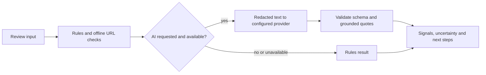

<div align="center">


# OvěřTo.AI

[](https://github.com/yuanweize/OverTo.AI/actions/workflows/ci.yml)
[](LICENSE)

**A clearer next step for suspicious messages.**

An experimental assistant for Czech messages, with a Czech/English analysis interface that highlights potential warning signs and helps people independently verify a suspicious SMS, email, or request.

[Český přehled](README.cs.md) · [API reference](docs/api/v1.md) · [Self-hosting guide](docs/deployment/self-host.md) · [Implementation status](docs/development/IMPLEMENTATION-STATUS.md) · [Privacy](PRIVACY.md) · [Security](SECURITY.md)

</div>


> **Deployment status:** Production-hardened self-hosted release with PostgreSQL transactional ledger, Better Auth with email verification, distributed rate limiting, AI monetary budget guard, and automated migrations. Production deployments and public Demos default to **Rules-only** mode (deterministic rule engine); external LLM inference remains governed by deployment security gates (`AI_LOCAL_ONLY`). Does not claim 100% scam detection accuracy; always verify critical requests out-of-band.

[Capabilities](#what-it-does) · [Quick start](#quick-start) · [API](#api-at-a-glance) · [Architecture](#how-it-works) · [Administration](#administration-and-observability) · [Development](#development)

## What it does

- **Review first.** Best-effort redaction and an editable preview help users review text before sending it. Redaction is incomplete and is not a privacy guarantee.
- **Find signals.** Deterministic rules and offline URL parsing identify potential warning signs without visiting links.
- **Use AI only with consent.** An optional OpenAI-compatible model endpoint proposes structured signals; schema and quotation checks reject invalid output. If unavailable, the application falls back to rules and reports the actual mode.
- **Take the next step.** Results show uncertainty and suggest independent verification, including guidance for urgent situations.
- **Experiment with an API.** A versioned endpoint returns structured results and a graph linking evidence to text. Results are not stored for retrieval.

The model integration has mock tests and limited real-model smoke tests; no independently reviewed representative accuracy study has been completed. See [evaluation](docs/evaluation/ai-evaluation.md) and [limitations](LIMITATIONS.md).

## Quick start

Requires Node.js 22 or newer and npm. The default development server binds to loopback.

```sh
npm ci
npm run dev -- -p 3005
```

Open the local server in your browser. The default is rules-only when no AI key is configured. To enable experimental AI locally, copy `.env.example` to `.env.local`, set the server-side provider key and model, and follow [AI_USAGE.md](AI_USAGE.md). Do not commit credentials or use real personal data for testing.

### Self-Hosted Production SaaS with Docker Compose

To deploy the full application with PostgreSQL, versioned schema migrations, production authentication, and SMTP notifications:

```sh
# 1. Prepare environment configuration
cp .env.selfhost.example .env.selfhost
# Edit .env.selfhost with strong random secrets and your domain/SMTP settings

# 2. Start services (PostgreSQL, automated migrations, Next.js app)
docker compose --env-file .env.selfhost -f compose.saas.yaml up -d --build

# 3. Bootstrap your initial platform root administrator
docker compose --env-file .env.selfhost -f compose.saas.yaml run --rm --no-deps migrate \
  ./node_modules/.bin/tsx scripts/bootstrap-admin.ts admin@yourdomain.com
```

The application health check is available at `/api/v1/health`. Database backups and restoration are verified with `scripts/test-backup-restore.ts`. See [Self-Hosting Guide](docs/deployment/self-host.md).

#### Port Allocation Matrix

| Mode | OverTo App | Mailpit Web UI | Mailpit SMTP | PostgreSQL |
|---|---|---|---|---|
| **Local Dev** (`npm run dev -- -p 3005`) | `http://127.0.0.1:3005` | `http://127.0.0.1:8025` | `127.0.0.1:1025` | `127.0.0.1:55443` |
| **Self-Host Compose** (`compose.saas.yaml`) | `http://127.0.0.1:3006` | `http://127.0.0.1:8026` | `mailpit:1025` | `127.0.0.1:5432` |

## API at a glance

A local guest request requires **no API key** and consumes no credits:

```sh
curl http://127.0.0.1:3005/api/v1/analyses \
  -H 'Content-Type: application/json' \
  --data '{"text":"Podezřelá zpráva", "enableLlm":false}'
```

An explicitly configured local account can create a project-scoped test key with rules or AI scope, expiration and a daily request limit. Send it as a bearer token with a fresh `Idempotency-Key`. Rotation revokes the old secret while preserving the quota lineage. Successful test-key requests consume test credits. Keys are local experiments and cannot authenticate production clients. See [the complete API reference](docs/api/v1.md) and [OpenAPI contract](docs/api/openapi.yaml).

Request size, text length and per-process rate and concurrency circuit breakers are bounded. In the local account deployment, guest requests now have a shared PostgreSQL ceiling of 90/minute and 3,000/day; guest AI attempts have an additional 4/minute and 24/day ceiling. Authenticated local requests have shared key/project/workspace limits. The rules-only container still has process-local guest protection. Production AI returns a rules fallback without calling a provider. These controls are **not complete public abuse protection or a monetary provider spending cap**. Do not expose the API publicly before production authentication, trusted proxy handling, shared per-client quotas, monitoring and provider spending controls are implemented and verified. See [security](SECURITY.md).

## How it works



With consent, the configured model endpoint and any upstream provider may receive data remaining after redaction, including URL hosts. Hosting and provider retention depend on their configuration and terms. The application does not store submitted message contents in a database. Read [privacy details](PRIVACY.md) before use.

## Account and billing capabilities

In local development (`3005`), a dedicated local PostgreSQL and loopback-only Mailpit (`8025`) capture sensitive one-time links without delivering real emails. In self-hosted production (`compose.saas.yaml` on `3006`), real SMTP delivery (or Mailpit via `--profile test-mail`) and PostgreSQL 17 persistence are fully supported. Stripe Test Mode provides verified sandbox checkout, webhook idempotency, credit grants, billing portal access, cancellation, failure handling, and refund clawbacks. Setup and test results are recorded in [implementation status](docs/development/IMPLEMENTATION-STATUS.md), [acceptance matrix](docs/development/ACCEPTANCE-MATRIX.md), and [credit ledger](docs/saas/ledger.md).

## Administration and observability

Platform administrators (`ROOT`) can manage public branding with version-conflict detection and transactional audit history. Initial root assignment is performed via `scripts/bootstrap-admin.ts`. The [operations console](docs/administration/operations.md) provides real-time tenant metrics, transactional audit logs, and system health status. See [site settings](docs/administration/site-settings.md) for supported branding fields.

The AI Studio records trace metadata, token usage, duration, and estimated USD costs in PostgreSQL. Message bodies are never stored; administrator-authored prompt versions **are** stored as configuration. The [Prompt Lab](docs/administration/prompts.md) provides immutable versioning, live model testing, and optimistic-locked activation/rollback. The [evaluation console](docs/administration/evaluations.md) executes deterministic test suites and bounded AI checks. [Model service settings](docs/administration/providers.md) configure registered endpoints, default and allowed models, timeouts, output caps, and health verification. Concurrent spending is protected by PostgreSQL row/advisory locks and fail-closed caps (`migrations/016_ai_budget_reservations.sql`). See [AI traces](docs/administration/ai-traces.md).

## Visual Showcase & Interface Gallery

### 1. Evidence-Led Analysis & Landing Experience

<p align="center">
  
  <br />
  <sub><strong>Analysis Result & Verdict (Czech, 1440px Desktop)</strong> — Grounded evidence excerpts, risk assessment score, and verified out-of-band next steps.</sub>
</p>

| English Dark Mobile Analysis (390px) | Czech Dark Mobile Home (390px) |
|:---:|:---:|
| <br /><sub><strong>Evidence-led Analysis (Dark Mobile)</strong></sub> | <br /><sub><strong>Interactive Hero & Input (Dark Mobile)</strong></sub> |

### 2. Tenant Dashboard & Developer Console

<p align="center">
  
  <br />
  <sub><strong>Personal Workspace Dashboard (1440px Desktop)</strong> — Synthetic usage activity, credit balance, and project management.</sub>
</p>

| API Keys & Quota Lineage (1440px Desktop) | Interactive API Playground (1440px Desktop) |
|:---:|:---:|
| <br /><sub><strong>API Keys & Shared Daily Limits</strong> — Scoped permissions, token lineage & rate limits.</sub> | <br /><sub><strong>Interactive API Playground</strong> — Live request testing with formatted JSON response.</sub> |

| Developer API Reference (1024px Tablet) | Sandbox Billing & Stripe Portal (1440px Desktop) |
|:---:|:---:|
| <br /><sub><strong>Developer Documentation (Dark Tablet)</strong> — WCAG AA accessible API reference.</sub> | <br /><sub><strong>Credit Ledger & Subscriptions</strong> — Metered credit allocation & test billing.</sub> |

### 3. Platform Administration & AI Studio (ROOT Only)

<p align="center">
  
  <br />
  <sub><strong>Platform Operations Console (1440px Desktop)</strong> — Live tenant statistics, transactional audit logs, and system health status.</sub>
</p>

| AI Studio Traces & Budgets (Dark Mode) | Prompt Lab & Rollback Management |
|:---:|:---:|
| <br /><sub><strong>AI Studio Operational Traces (Dark Mode)</strong> — Real Token usage, duration, and atomic budget tracking.</sub> | <br /><sub><strong>Prompt Lab & Version Control</strong> — Immutable prompt versioning, testing, and audited rollback.</sub> |

<details>
<summary><strong>View Additional Screenshots (Mobile Views & Light/Dark Modes)</strong></summary>

| View | Screenshot Preview |
|---|---|
| Czech Pricing (1440px Desktop) | <br /><sub><strong>Pricing (Czech, 1440px)</strong></sub> |
| English Documentation (1024px Desktop) | <br /><sub><strong>Documentation (English, 1024px)</strong></sub> |
| Model Registry & Health Checks | <br /><sub><strong>Registered AI Providers & Health Verification</strong></sub> |
| User Table & Identity Search | <br /><sub><strong>Platform Admin User Management & Credit Adjustments</strong></sub> |
| Czech Billing (Dark Mobile, 390px) | <br /><sub><strong>Billing & Credits (Dark Mobile)</strong></sub> |
| Czech API Keys (Dark Mobile, 390px) | <br /><sub><strong>API Keys (Dark Mobile)</strong></sub> |
| Czech Dashboard (Dark Mobile, 390px) | <br /><sub><strong>Dashboard (Dark Mobile)</strong></sub> |
| Admin Overview (Dark Mobile, 390px) | <br /><sub><strong>Admin Operations (Dark Mobile)</strong></sub> |
| AI Studio (Light Desktop) | <br /><sub><strong>AI Studio Traces (Light Desktop)</strong></sub> |

</details>

Theme and language choices persist across sessions. Public pages, authentication forms, and account screens have complete Czech and English catalogs. See [three-round visual review](docs/design/FINAL-VISUAL-REVIEW.md), [public reference review](docs/design/OPENROUTER-REFERENCE-REVIEW.md), and [branding policy](BRANDING.md).

## Model providers

Set `OPENAI_BASE_URL`, `OPENAI_MODEL`, and server-only `OPENAI_API_KEY` in `.env.local` or `.env.selfhost`. The adapter accepts OpenAI-compatible `/v1/chat/completions` endpoints. Root administrators can select only endpoints registered by the operator through `OPENAI_BASE_URL` or `AI_ALLOWED_BASE_URLS`. Concurrency race conditions and spending caps are enforced atomically via `AiBudgetGuard` (`migrations/016_ai_budget_reservations.sql`). When budget caps are exhausted, requests fail closed and fall back to deterministic rules. The `/models` check is an explicit admin action and does not test completion quality.

## Development

```sh
npm test
npx tsc --noEmit
npm run lint
npm run build
npm run eval
npm run docs:check
npm run docs:check -- --remote
```

PostgreSQL integration tests need a separate disposable database; browser account journeys also need the dedicated local PostgreSQL and Mailpit described in the [development status](docs/development/IMPLEMENTATION-STATUS.md). `npm run eval` uses synthetic examples without model requests. The explicitly invoked `npm run eval -- --live` makes provider calls and can incur charges.

For independent acceptance, use the [AI](docs/testing/AI-TEST-PLAN.md), [browser](docs/testing/FULL-E2E-TEST-PLAN.md), [security](docs/testing/SECURITY-TEST-PLAN.md) and [deployment](docs/testing/DEPLOYMENT-TEST-PLAN.md) test plans. They distinguish verified local behavior from public release gates.

## Contributing and license

See [CONTRIBUTING.md](CONTRIBUTING.md). Project code is offered under [Apache-2.0](LICENSE); third-party components retain their own licenses. The project responds to the [AI výzva pro Česko](https://mesic.ai/#soutez); no affiliation with the organizer is implied.
