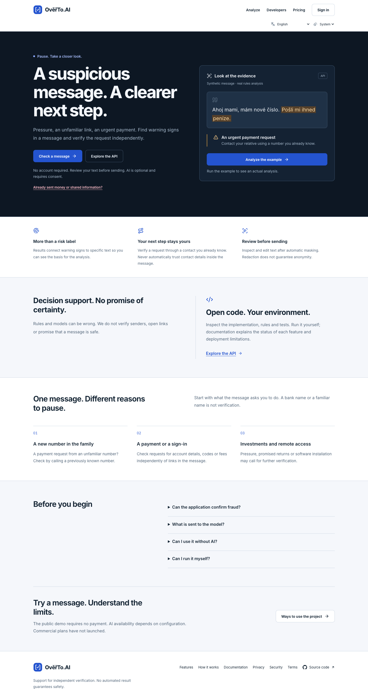
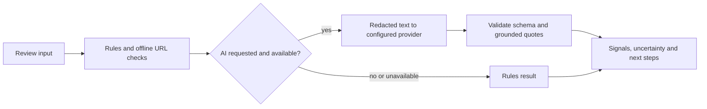

<div align="center">


# OvěřTo.AI

[](https://github.com/yuanweize/OverTo.AI/actions/workflows/ci.yml)
[](LICENSE)

**A clearer next step for suspicious messages.**

An experimental assistant for Czech messages, with a Czech/English analysis interface that highlights potential warning signs and helps people independently verify a suspicious SMS, email, or request.

[Český přehled](README.cs.md) · [Local documentation](http://127.0.0.1:3005/docs) · [API reference](docs/api/v1.md) · [Self-hosting status](docs/development/IMPLEMENTATION-STATUS.md) · [Privacy](PRIVACY.md) · [Security](SECURITY.md)

</div>



> **Development status:** This is not a production SaaS. Public accounts, production API keys, distributed abuse protection, commercial billing and public deployment are not ready. It cannot verify a sender's identity, prove fraud, or guarantee that a message is safe.

[Capabilities](#what-it-does) · [Quick start](#quick-start) · [API](#api-at-a-glance) · [Architecture](#how-it-works) · [Administration](#administration-and-observability) · [Development](#development)

## What it does

- **Review first.** Best-effort redaction and an editable preview help users review text before sending it. Redaction is incomplete and is not a privacy guarantee.
- **Find signals.** Deterministic rules and offline URL parsing identify potential warning signs without visiting links.
- **Use AI only with consent.** An optional OpenAI-compatible model endpoint proposes structured signals; schema and quotation checks reject invalid output. If unavailable, the application falls back to rules and reports the actual mode.
- **Take the next step.** Results show uncertainty and suggest independent verification, including guidance for urgent situations.
- **Experiment with an API.** A versioned endpoint returns structured results and a graph linking evidence to text. Results are not stored for retrieval.

The model integration has mock tests and limited real-model smoke tests; no independently reviewed representative accuracy study has been completed. See [evaluation](docs/evaluation/ai-evaluation.md) and [limitations](LIMITATIONS.md).

## Quick start

Requires Node.js 22 or newer and npm. The default development server binds to loopback.

```sh
npm ci
npm run dev -- -p 3005
```

Open [http://127.0.0.1:3005](http://127.0.0.1:3005). The default is rules-only when no AI key is configured. To enable experimental AI locally, copy `.env.example` to `.env.local`, set the server-side provider key and model, and follow [AI_USAGE.md](AI_USAGE.md). Do not commit credentials or use real personal data for testing. A model request may incur provider charges.

A rules-only container can also be started with `docker compose up --build` on `http://127.0.0.1:3006`. The image was previously tested on arm64; public deployment and other architectures are not validated.

## API at a glance

A local guest request requires **no API key** and consumes no credits:

```sh
curl http://127.0.0.1:3005/api/v1/analyses \
  -H 'Content-Type: application/json' \
  --data '{"text":"Podezřelá zpráva", "enableLlm":false}'
```

An explicitly configured local account can create a project-scoped test key with rules or AI scope, expiration and a daily request limit. Send it as a bearer token with a fresh `Idempotency-Key`. Rotation revokes the old secret while preserving the quota lineage. Successful test-key requests consume test credits. Keys are local experiments and cannot authenticate production clients. See [the complete API reference](docs/api/v1.md) and [OpenAPI contract](docs/api/openapi.yaml).

Request size, text length and per-process rate and concurrency circuit breakers are bounded. Authenticated local requests additionally use shared PostgreSQL key/project/workspace limits. Anonymous rules traffic still has only process-local protection; production AI is blocked. These controls are **not complete public abuse protection or a provider spending cap**. Do not expose the API publicly before production authentication, trusted proxy handling, shared per-client quotas, monitoring and provider spending controls are implemented and verified. See [security](SECURITY.md).

## How it works



With consent, the configured model endpoint and any upstream provider may receive data remaining after redaction, including URL hosts. Hosting and provider retention depend on their configuration and terms. The application does not store submitted message contents in a database. Read [privacy details](PRIVACY.md) before use.

## Local account and billing experiments

A dedicated local PostgreSQL and loopback-only Mailpit support signup, email verification, password recovery, projects, test API keys and credits. Mailpit captures sensitive one-time links and does not deliver real email. Production auth and real email are disabled. Stripe Test Mode is disabled by default. An [actual sandbox checkout, signed webhooks, credit grant, portal opening and cancellation](docs/saas/stripe-live-test.md) have been verified; renewal, failure handling and reconciliation still need acceptance. Never use live Stripe keys here. Setup, test results and remaining work are recorded in [implementation status](docs/development/IMPLEMENTATION-STATUS.md), [acceptance matrix](docs/development/ACCEPTANCE-MATRIX.md), and [credit ledger](docs/saas/ledger.md).

## Administration and observability

Verified platform administrators can edit public branding with validated settings, version-conflict detection and transactional audit history. First-root assignment is a trusted local CLI operation. [Site settings](docs/administration/site-settings.md) explains the supported fields and current deployment boundary.

The local AI Studio shows trace metadata and 24-hour operational counts. Message contents are not stored; administrator-authored prompt versions **are** stored as configuration. Missing tokens and cost remain unknown. The [Prompt Lab](docs/administration/prompts.md) supports immutable drafts, real tests and audited activation/rollback. The [evaluation console](docs/administration/evaluations.md) runs the authored rules set and bounded AI smoke tests. [Model service settings](docs/administration/providers.md) control the registered endpoint, default and allowed models, timeout, output cap and an explicit metadata-only connection check. Dataset editing, multi-provider routing and production budgets remain unfinished. See [AI traces](docs/administration/ai-traces.md).

| Current view | Screenshot |
|---|---|
| Czech dark mobile home | [View](assets/screenshots/v7-home-cs-dark-390.png) |
| English dark mobile analysis | [View](assets/screenshots/v7-analyze-en-dark-390.png) |
| Czech dashboard, synthetic test account | [View](assets/screenshots/v7-dashboard-cs-1440.png) |
| Czech dashboard, dark mobile | [View](assets/screenshots/v7-dashboard-cs-dark-390.png) |
| Czech API keys and shared daily usage | [View](assets/screenshots/v7-api-keys-cs-1440.png) |
| Czech API keys, dark mobile | [View](assets/screenshots/v7-api-keys-cs-dark-390.png) |
| Czech billing, light desktop and dark mobile | [Desktop](assets/screenshots/v7-billing-cs-1440.png) · [Mobile](assets/screenshots/v7-billing-cs-dark-390.png) |
| Czech API Playground with structured result | [View](assets/screenshots/v7-playground-cs-1440.png) |
| English workspace, synthetic test account | [View](assets/screenshots/v7-workspace-mobile.png) |
| Czech pricing, desktop | [View](assets/screenshots/v7-pricing-cs-1440.png) |
| English documentation, desktop | [View](assets/screenshots/v7-docs-en-1024.png) |
| AI Studio models, synthetic administrator | [View](assets/screenshots/v7-model-registry.png) |
| Administrator settings, synthetic test branding | [View](assets/screenshots/v6-admin-settings.png) |
| AI Studio traces, light and dark | [Light](assets/screenshots/v7-ai-studio-en-light.png) · [Dark](assets/screenshots/v7-ai-studio-en-dark.png) |

Theme and language choices persist. Public pages, authentication forms and account screens have Czech and English catalogs. Backend error responses and email templates still need localization. See the [three-round visual review](docs/design/FINAL-VISUAL-REVIEW.md), [public reference review](docs/design/OPENROUTER-REFERENCE-REVIEW.md) and [branding policy](BRANDING.md). Screenshots show local operation, not a hosted production SaaS.

## Model providers

Set `OPENAI_BASE_URL`, `OPENAI_MODEL` and the server-only `OPENAI_API_KEY` in ignored `.env.local`. The adapter accepts an OpenAI-compatible `/v1/chat/completions` endpoint. Root administrators can choose only endpoints registered by the server operator through `OPENAI_BASE_URL` or `AI_ALLOWED_BASE_URLS`; the latter is a comma-separated list for trusted alternatives. Local HTTP gateways are permitted only on an address assigned to the development machine. Provider names and model IDs are configuration, not product branding. No key is written to PostgreSQL or returned to the browser. The `/models` check is an explicit admin action and does not test completion quality. Production paid AI remains blocked until distributed authorization and spending controls are accepted.

## Development

```sh
npm test
npx tsc --noEmit
npm run lint
npm run build
npm run eval
npm run docs:check
npm run docs:check -- --remote
```

PostgreSQL integration tests need a separate disposable database; browser account journeys also need the dedicated local PostgreSQL and Mailpit described in the [development status](docs/development/IMPLEMENTATION-STATUS.md). `npm run eval` uses synthetic examples without model requests. The explicitly invoked `npm run eval -- --live` makes provider calls and can incur charges.

For independent acceptance, use the [AI](docs/testing/AI-TEST-PLAN.md), [browser](docs/testing/FULL-E2E-TEST-PLAN.md), [security](docs/testing/SECURITY-TEST-PLAN.md) and [deployment](docs/testing/DEPLOYMENT-TEST-PLAN.md) test plans. They distinguish verified local behavior from public release gates.

## Contributing and license

See [CONTRIBUTING.md](CONTRIBUTING.md). Project code is offered under [Apache-2.0](LICENSE); third-party components retain their own licenses. The project responds to the [AI výzva pro Česko](https://mesic.ai/#soutez); no affiliation with the organizer is implied.
