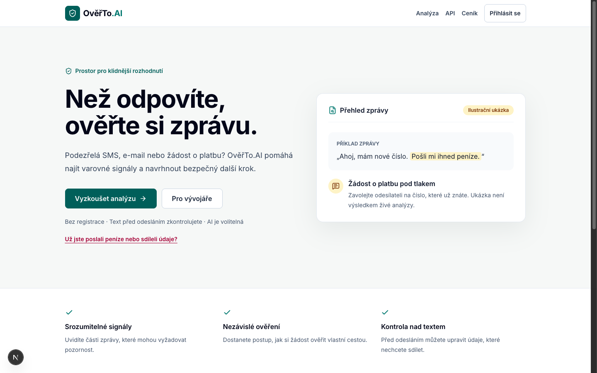
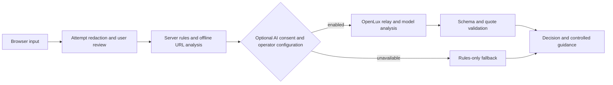

# OvěřTo.AI

Czech-language experimental assistant for examining suspicious messages and guiding independent verification. The tool cannot verify sender identity, open target sites, prove a scam, or guarantee safety. [Česky](README.cs.md).

## Status

- **Implemented:** local attempted redaction and editable review, rules and offline URL checks, opt-in OpenLux-compatible structured-output integration with validation and fallback, and a branching verification guide.
- **Experimental:** AI integration has mock tests and limited real model smoke tests. It is disabled by default; individual provider availability varies. No independently reviewed or representative accuracy study has been completed.
- **Not yet available:** public demo, independent AI evaluation, OCR, distributed rate limiting and production deployment. Do not expose the AI endpoint publicly without enforcing real quotas and spending limits.
- **Local account experiment:** on an explicitly configured development server only, users can sign up, sign in, create projects and test API keys, and receive a one-time test credit grant. Email verification, password reset, production accounts and billing are not available. Do not use real credentials. See [development status](docs/development/IMPLEMENTATION-STATUS.md).
- **Local metering experiment:** signed-in local analyses reserve and settle test credits and record metadata-only usage. This is not production billing; subscriptions, payments, reconciliation and robust failure recovery remain incomplete. See [ledger status](docs/saas/ledger.md).

## Product preview



The workspace supports redaction review, optional AI, grounded excerpts and contextual verification. The experimental action graph links observed signals or model-proposed actions to matching text; it does not prove identity, intent, or fraud.

## API and deployment

`POST /api/v1/analyses` returns an ephemeral versioned result and evidence graph. See [API documentation](docs/api/v1.md). Results are not stored. Retrieval, commercial accounts, production API keys and admin controls are not yet implemented.

A self-hosted rules-only container can be started using `docker compose up --build` and accessed at `http://127.0.0.1:3006`. The image was tested on arm64; public deployment, rate limits, model billing controls and other architectures have not been validated. Cloudflare Workers and OCR are planned, not deployed.

## Flow



## Run locally

Node.js 22 or newer and npm are required.

```sh
npm ci
npm run dev
npm test
npx tsc --noEmit
npm run lint
npm run build
npm run eval
```

The default is rules-only. For experimental OpenLux integration copy `.env.example` to `.env.local`, set a server-side API key and model, and read [AI_USAGE.md](AI_USAGE.md). The operator assertion flag is **not a rate limiter**. Do not commit keys. `npm run eval` uses synthetic examples and makes no model requests. A live evaluation is explicitly invoked with `npm run eval -- --live` and can incur API charges.

## Privacy and limitations

Redaction cannot find every personal detail. Users must review text before sending; the server and, only with consent and enabled configuration, OpenLux and its upstream provider receive the remaining text and URL hosts. Provider and hosting retention depend on their settings and terms. This application uses no message database. See [PRIVACY.md](PRIVACY.md), [SECURITY.md](SECURITY.md), [LIMITATIONS.md](LIMITATIONS.md) and [evaluation results](docs/evaluation/ai-evaluation.md).

The project responds to the [AI výzva pro Česko](https://mesic.ai/#soutez). Similar tools exist, including Kriticky.cz and Kybertest. Contributions are welcome under [CONTRIBUTING.md](CONTRIBUTING.md); project code is offered under [Apache-2.0](LICENSE), subject to third-party licenses. No affiliation with the competition organizer is implied.
