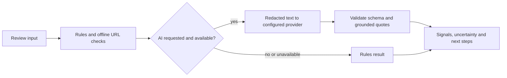

<div align="center">

# OvěřTo.AI

**A clearer next step for suspicious messages.**

An experimental Czech-language assistant that highlights potential warning signs and helps people independently verify a suspicious SMS, email, or request.

[Český přehled](README.cs.md) · [API reference](docs/api/v1.md) · [Privacy](PRIVACY.md) · [Security](SECURITY.md) · [Project status](docs/development/IMPLEMENTATION-STATUS.md)

</div>


> **Development status:** This is not a production SaaS. Public accounts, production API keys, distributed abuse protection, commercial billing and public deployment are not ready. It cannot verify a sender's identity, prove fraud, or guarantee that a message is safe.

## What it does

- **Review first.** Best-effort redaction and an editable preview help users review text before sending it. Redaction is incomplete and is not a privacy guarantee.
- **Find signals.** Deterministic rules and offline URL parsing identify potential warning signs without visiting links.
- **Use AI only with consent.** An optional OpenLux-compatible model proposes structured signals; schema and quotation checks reject invalid output. If unavailable, the application falls back to rules and reports the actual mode.
- **Take the next step.** Results show uncertainty and suggest independent verification, including guidance for urgent situations.
- **Experiment with an API.** A versioned endpoint returns structured results and a graph linking evidence to text. Results are not stored for retrieval.

The model integration has mock tests and limited real-model smoke tests; no independently reviewed representative accuracy study has been completed. See [evaluation](docs/evaluation/ai-evaluation.md) and [limitations](LIMITATIONS.md).

## Quick start

Requires Node.js 22 or newer and npm. The default development server binds to loopback.

```sh
npm ci
npm run dev -- -p 3005
```

Open [http://127.0.0.1:3005](http://127.0.0.1:3005). The default is rules-only when no AI key is configured. To enable experimental AI locally, copy `.env.example` to `.env.local`, set the server-side provider key and model, and follow [AI_USAGE.md](AI_USAGE.md). Do not commit credentials or use real personal data for testing. A model request may incur provider charges.

A rules-only container can also be started with `docker compose up --build` on `http://127.0.0.1:3006`. The image was previously tested on arm64; public deployment and other architectures are not validated.

## API at a glance

A local guest request requires **no API key** and consumes no credits:

```sh
curl http://127.0.0.1:3005/api/v1/analyses \
  -H 'Content-Type: application/json' \
  --data '{"text":"Podezřelá zpráva", "enableLlm":false}'
```

An explicitly configured local account can create a project-scoped test key and send it as a bearer token with a fresh `Idempotency-Key`. Successful test-key requests consume test credits. Keys are local experiments and cannot authenticate production clients. See [the complete API reference](docs/api/v1.md) and [OpenAPI contract](docs/api/openapi.yaml).

Request size, text length and per-process rate and concurrency circuit breakers are bounded. These shared, process-local limits are **not distributed protection or a provider spending cap**. Do not expose the API publicly before production authentication, trusted proxy handling, shared per-client quotas, monitoring and provider spending controls are implemented and verified. See [security](SECURITY.md).

## How it works



With consent, OpenLux and its model provider may receive data remaining after redaction, including URL hosts. Hosting and provider retention depend on their configuration and terms. The application does not store submitted message contents in a database. Read [privacy details](PRIVACY.md) before use.

## Local account and billing experiments

A dedicated local PostgreSQL and loopback-only Mailpit support signup, email verification, password recovery, projects, test API keys and credits. Mailpit captures sensitive one-time links and does not deliver real email. Production auth and real email are disabled. An experimental Stripe Test Mode path is disabled by default and has simulated webhook tests; a real test-mode checkout has not yet been verified. Never use live Stripe keys here. Setup, test results and remaining work are recorded in [implementation status](docs/development/IMPLEMENTATION-STATUS.md), [acceptance matrix](docs/development/ACCEPTANCE-MATRIX.md), and [credit ledger](docs/saas/ledger.md).

## Development

```sh
npm test
npx tsc --noEmit
npm run lint
npm run build
npm run eval
```

PostgreSQL integration tests need a separate disposable database; browser account journeys also need the dedicated local PostgreSQL and Mailpit described in the [development status](docs/development/IMPLEMENTATION-STATUS.md). `npm run eval` uses synthetic examples without model requests. The explicitly invoked `npm run eval -- --live` makes provider calls and can incur charges.

## Contributing and license

See [CONTRIBUTING.md](CONTRIBUTING.md). Project code is offered under [Apache-2.0](LICENSE); third-party components retain their own licenses. The project responds to the [AI výzva pro Česko](https://mesic.ai/#soutez); no affiliation with the organizer is implied.
